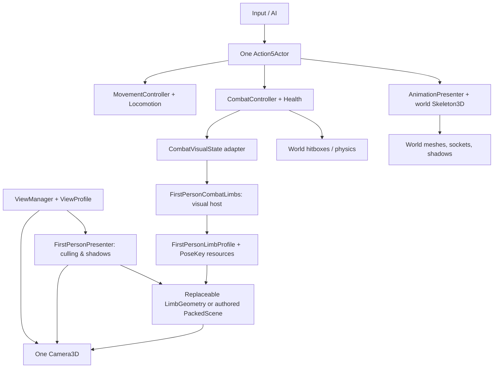

# First-person presentation architecture — research and D05 refactor

Status: D05 merged via [PR #28](https://github.com/bravado/ACTION-5/pull/28).
D06-01 equipped viewmodel/attack selection is in development in PR #31.

## Root-cause analysis

The bad F4 screenshot showed oversized circular limb ends and a knee/arm
that obscured the camera. The previous presenter took `Skeleton3D`
`get_bone_global_pose()` positions, subtracted the shoulder/hip origin,
multiplied the result by a scale and placed open-ended cylinders near the
camera. This **cannot be reliably fixed by changing one anchor**:

1. Godot's "bone global pose" is in **skeleton space**, *not world or camera
   space*. Source retargeting and bone-rest orientations change how this
   pose should be interpreted.
2. The world character's authored upper-arm rest silhouette and camera eye
   origins are different. Relative positions from a world standing pose
   do not define a usable first-person idle/guard pose.
3. A large cylinder too close to a perspective camera fills the frame
   and exposes circular end caps. Hard-coded camera offsets only fix
   one pose and one FOV.
4. The world animation and gameplay attack timelines must remain the
   same across all five perspectives; F4 has no authority to alter either.

Relevant primary references:
- Godot [Skeleton3D](https://docs.godotengine.org/en/stable/classes/class_skeleton3d.html):
  global pose is relative to the skeleton, not the world.
- Godot [retargeting guide](https://docs.godotengine.org/en/stable/tutorials/assets_pipeline/retargeting_3d_skeletons.html):
  different rest poses mean matching bone names is not sufficient.
- Godot [Camera3D](https://docs.godotengine.org/en/stable/classes/class_camera3d.html):
  FOV, frustum, visibility layers and `unproject_position` can
  validate camera-space authored coordinates.
- Godot [Using Viewports](https://docs.godotengine.org/en/stable/tutorials/rendering/viewports.html):
  one active camera per Viewport; alternate render passes require a
  separate SubViewport and composition.
- Godot [SubViewport](https://docs.godotengine.org/en/stable/classes/class_subviewport.html):
  stand-alone viewports need a display/container/texture, input routing
  and correct update sizing.
- Godot [AnimationTree](https://docs.godotengine.org/en/stable/tutorials/animation/animation_tree.html):
  the world animation graph remains a visual layer over game state.
- [NeoFPS first-person body design overview](https://docs.neofps.com/manual/fpcharacters-firstpersonbody.html):
  useful taxonomy (full body, torso+view arms, separate weapon rig).
  Architecture comparison only; not an ACTION-5 dependency.

## Options and decision

| Option | Benefits | Risks | Decision |
|---|---|---|---|
| Crop the world skinned mesh / reuse world rest pose | Single art rig, seamless mirrors | Camera intersects shoulders, clipping, arms badly framed during look pitch, retargeting complexity | Keep for F1–F3/F5 and world shadows; **not** F4 near-eye arms |
| Camera-local authored viewmodel with its own visual pose clips | Small stable near-eye geometry, predictable FOV, easy swapping, no gameplay coupling | Requires separate visual art/poses per action | **Chosen for D05** |
| Full first-person body awareness | See torso/feet when looking down | Needs character-body IK, camera obstruction handling, careful world pose constraints | Future *optional* visual plugin |
| Dedicated SubViewport weapon camera / independent FOV | Independent near clip and overlay compositing | Extra render pass, alpha/depth artifacts, WebGL2 compatibility/performance cost | Defer; current layer-19/single-camera approach is simpler |

The demo uses one world camera and **no SubViewport**. Godot camera-layer
culling is already sufficient for the small camera-local viewmodels.
Adding a second camera to the same Viewport would not create a second
independent rendered view.

## Architectural boundary

**Dependency rules:**

- Gameplay moves, attacks, HP, hitboxes and AI do **not** import any
  view/presentation class. Attack execution and authoritative physics
  ticks remain in CombatController.
- `CombatVisualState` is a one-way, replaceable adapter. Its public
  interface is `get_visual_action() -> Dictionary`, returning
  `{key:StringName, progress:float}` or `{}` while idle.
- `FirstPersonCombatLimbs` consumes **only the visual snapshot** and
  the existing `FirstPersonPresenter.register_first_person_visual()`
  port, not CombatController or Skeleton3D. The pose clock comes from
  the adapter, so switching F3↔F4 mid-attack resumes its current pose.
- `FirstPersonLimbProfile` is immutable authored data containing the
  action key, visibility at rest, camera-space keyframes and appearance.
  A profile's `viewmodel_scene` may replace demo capsules with artist
  supplied skinned geometry implementing `configure(profile)` and
  `apply_pose(progress)`.
- `FirstPersonLimbGeometry` is merely the default camera-local
  renderer. It **never reads** Combat, world rigs, camera state or input.
- `CombatAnimationAdapter` separately listens to gameplay and Health
  signals for the world-rig upper/full-body visuals. Its absence must not
  interrupt the combat clock or F4 visual-state snapshot. Neither
  `CombatController` nor `FirstPersonPresenter` calls world animation
  methods to start attacks.
- `FirstPersonPresenter` owns render layers: world body **20**,
  private viewmodel **19**, world shadows on **1**. No equipment type,
  attack ID or move-specific logic belongs in this class.
- F1/F2/F3/F5 always render the same imported world skeleton.
  F4 only changes camera projection and local visibility, **never**
  actor identity, collision, socket attachment, facing or time.

## Camera authoring contract

Use metres in *camera-local* coordinates: +X = screen right, +Y = up,
**-Z = forward**. Avoid using world-bone offsets as a substitute.

The demo F4 profile has a nominal 80° FOV. In the new Punch profile,
the **shoulder root is intentionally beyond the lower-right screen edge**,
near `(1.18, -1.02, -0.48)`, while the elbow remains inside at
`(0.68, -0.55, -0.95)` and the fist rests around
`(0.50, -0.53, -1.23)`. The visible forearm therefore emerges from
the screen edge as part of the player, rather than leaving a visible
upper-arm end cap in the scene. At nominal 80° FOV, the fist is about
66% across and 76% down; the elbow is about 77% across and 85% down.
The shoulder projects beyond the right and bottom edges even at 100°
FOV (the widest tested view).
During impact the fist extends away from the camera (more negative Z),
then returns to exactly the rest pose.

The Kick profile keeps the **hip/upper-thigh origin offscreen below the
bottom edge** in every authored pose, near `(0.22, -1.35, -0.85)`.
The visible thigh therefore extends to the screen border instead of ending
in a floating capsule cap. The knee and foot remain framed in the lower part
of the view; only the camera-space Kick pose asset changes (not movement,
damage timing, cameras, or the persistent Punch arm). Framing regressions
cover the offscreen hip and onscreen knee at 65°/80°/100° FOV and
632×404/1280×720/1024×768 viewports.
At knee chamber (`progress≈0.22`), its knee is around
`(0.22, -0.61, -1.31)`, and during extension its foot moves farther
along -Z while remaining below the centerline. This is not an IK
solution; it is an explicitly authored viewmodel pose and can be
replaced by production art without gameplay edits.

The placeholder renderer uses **rounded, thin capsules**, not huge
cylinders with exposed flat ends. Radius is measured in metres;
`FirstPersonLimbProfile.valid()` rejects nonfinite, inverted or
near-camera poses.

## Extending to an entirely new attack or model

1. Add a new `Action5AttackDefinition` and a clip mapping for the
   imported world rig. No core movement/animation branches.
2. Create a `FirstPersonLimbProfile` with a matching `animation_key`,
   `PoseKey` frames normalized from 0 to 1, and optional
   `visible_at_rest`. The pose resource sets only visual geometry.
3. Add the profile to the actor's `FirstPersonCombatLimbs.profiles`.
   For production assets, assign a `PackedScene` with two visual
   functions `configure(profile)` and `apply_pose(progress)`.
4. If action data comes from a different system (e.g. interaction,
   equipment or emote), inject a node implementing
   `get_visual_action()` through `visual_state_path`. No changes to
   the renderer or camera are required.
5. Test F4 render/culling and every pose, cancellation, disabled input,
   F3↔F4 mid-action, crouch/jump, near wall and a dynamically registered
   third action. Inspect native/WebGL2 screenshots at 16:9 and narrower
   viewports; verify the projected fist/knee/end are within expected
   ranges, not just the action name in a log.

**D06** attaches world equipment to the D04 socket, then optionally
registers a separate camera-local viewmodel on the same layer 19 and
consumes a visual adapter. When equipment is active, a replaceable
visibility source hides D05's unarmed F4 arm and leg; the equipment F4
scene instead uses an authored `FirstPersonLimbProfile` for its own
hand/forearm, with all held weapon meshes parented to that hand's
animated grip. Input selection is handled before combat by the optional
`EquipmentAttackSelector`: existing clicks/J/K request equipped
actions, without a special swing key or weapon type branch. **Do not make Combat or
FirstPersonPresenter know weapon type names.** A viewmodel is never a
second actor and never owns damage or ammo.

## Acceptance and limitations

Required:
- Right arm emerges from the lower-right screen edge at all authored
  poses (shoulder kept offscreen, elbow and fist remain visible); Punch
  chambers/extends/recovers, with no duplicate fake tool.
- Kick knee enters in the lower half of the frame, foot advances, and
  neither limb clips the near plane at default FOV.
- F1–F3/F5 show the unmodified world body, all views retain the same
  actor/attack state and skinned world shadows.
- Third attack needs *only* new resources; viewmodel scene can be swapped.
- Native/headless tests and WebGL2 5-view browser screenshots must pass.
- Manual review still needed for production-quality art, FOV extremes,
  and aspect ratios after code/CI validation.

The demo uses capsules and boxes as *reproducible placeholder art*;
it is structurally ready for a high-quality imported first-person rig.
